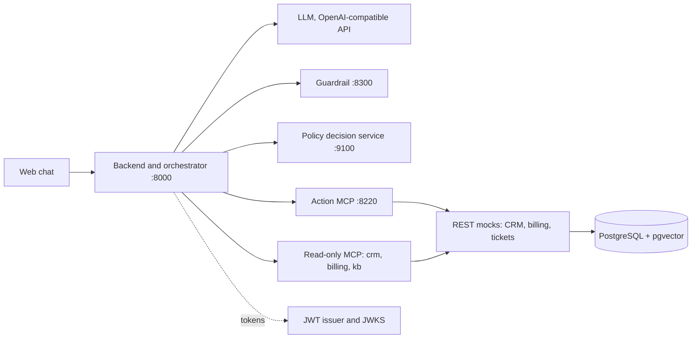

# Telco Support Agent

A support chat for a mobile carrier's website, built from several narrow AI
agents. It answers subscribers' questions about their plan, charges and rules
with links to the knowledge base, and changes a plan, service or contact only
after the subscriber confirms a card that shows exactly what will change.

[](https://github.com/denbon05/llm-developer-project-445/actions)

> **Status:** in development. The stand, the checks and the read-only agents
> run; actions, policies and the guardrail are being built step by step.

## Highlights

- **The model proposes, code decides.** The LLM plans the turn and writes the
  reply. Code validates the plan, a policy service allows each action, and
  code recognizes the subscriber's "yes".
- **Confirmation cards with idempotent execution.** A plan change runs only
  after an explicit confirmation, and a repeated "yes" never runs it twice.
- **A JWT in every call.** MCP servers check the token's audience and read the
  subscriber from it, never from tool arguments.
- **Policy as code.** Confirmation windows and per-session limits live in
  Dogwood policies evaluated by a separate decision service. If the service is
  unreachable, actions are closed.
- **A guardrail that fails closed for writes.** Text is checked before and after
  the model. If the guardrail is down, reading still works and actions stop.
- **A full audit trail.** Actions, refusals, model calls and tool calls share a
  trace id, so any turn can be reconstructed.

## How it works



The stand (port 8100) hosts the web chat, the read-only MCP servers, the REST
mocks of the carrier's systems and the token issuer. Everything else talks to
it the way it would talk to real business systems. Terms are explained in the
[glossary](docs/glossary.md).

## Stack

Python 3.12, OpenAI Agents SDK, MCP over streamable HTTP, FastAPI, PostgreSQL 16
with pgvector, Dogwood policies, PyJWT (RS256), uv, ruff, basedpyright.

## Quick start

Prerequisites: Docker, [uv](https://docs.astral.sh/uv/), and
[LM Studio](https://lmstudio.ai/) (or any OpenAI-compatible endpoint) with a
chat model and the `text-embedding-embeddinggemma-300m-qat` embedding model.

```bash
git clone https://github.com/denbon05/llm-developer-project-445.git
cd llm-developer-project-445
make install          # dependencies via uv
cp .env.example .env  # set LLM_BASE_URL, LLM_MODEL, LLM_API_KEY
make infra            # PostgreSQL + pgvector in Docker
make migrate seed     # schema and demo data
make stand            # the stand on :8100; keep it running
```

Then start the other processes, each in its own terminal: `make api`,
`make actions`, `make pdp` and `make guardrail`. Open http://127.0.0.1:8100 and
pick a demo user:

| User | Role | Can do |
| --- | --- | --- |
| `anna` | subscriber | read, and change her plan through a confirmation card |
| `boris` | subscriber | read only |
| `olga` | support operator | view subscribers, no changes |

`make reset` restores the demo data at any time.

## Testing

- `make test` runs the unit tests; they need no services.
- `make smoke` runs checks that need no model, grouped by component:
  `make smoke G=0` checks the stand.
- `make scenarios` runs end-to-end dialogs from `data/dialogs/` on a live model.
- `make lint` and `make format` run ruff and pylint.

## Background

Built as a project of the [Hexlet LLM developer program](https://ru.hexlet.io/programs/llm-developer).
The stand comes from the course starter template; the `hexlet-check` workflow
runs the course's automated checks on every push. The chat and the knowledge
base are in Russian for now; an English version is planned.
